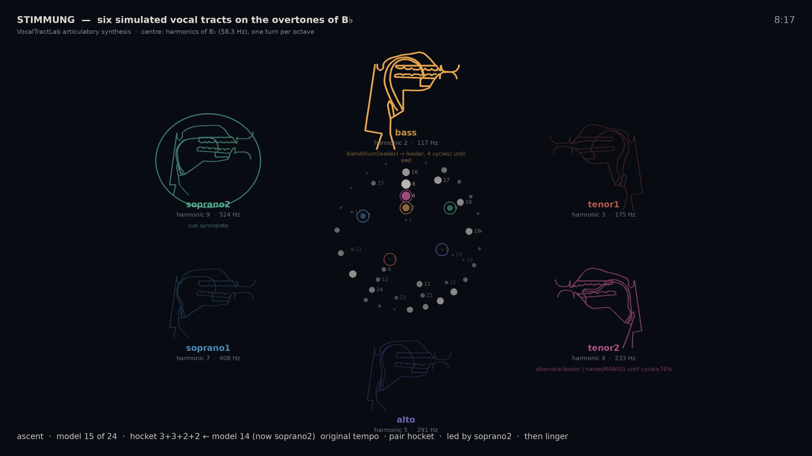

# stimmung

A generative piece for six synthetic voices in the manner of Stockhausen's *Stimmung*,
sung by articulatory vocal-tract models ([VocalTractLab](https://www.vocaltractlab.de/), Birkholz).

▶ **Listen / watch:** [latest render on YouTube](https://www.youtube.com/watch?v=z-PeF35nsY0)

Every pitch is a harmonic of B-flat 1 (58.27 Hz). Each singer holds one fundamental
(harmonics 2, 3, 4, 5, 7, 9) and moves only its overtones, by retuning the shape of its
vocal tract so that a formant sits exactly on a chosen harmonic.

The piece is a chain of *models*: a leader presents a pattern alone and the others
"identify" with it one at a time — copying it in unison, in canon, by taking over some of
its notes, or transforming it. How each singer behaves in each model is a small program
sampled from a probabilistic grammar (`src/dsl.py`), so the strategies differ from model
to model and from singer to singer, and evolve over the piece.

## Reading the video

[](https://www.youtube.com/watch?v=z-PeF35nsY0)

**The six singers** sit on a ring, each drawn as the side view of their simulated
vocal tract (lips, tongue, palate, velum, larynx, as exported by VocalTractLab at that
moment), facing the centre. Bass is at the top; going clockwise come tenor1, tenor2,
alto, soprano1 and soprano2. The same layout sets where each voice sits in the stereo
mix. Each singer's elements:

- **Outline brightness and thickness**: how loud the singer is right now (lung
  pressure × gain). Silent singers fade almost into the background.
- **Above the tract**: what the singer is singing, in IPA, e.g. `/no/`, `/m/ hum`,
  `whispered`. When the singer is tuning an overtone it adds `overtone n`, meaning the
  n-th harmonic of *that singer's own* note.
- **Below the name**: the singer's fixed note, as a harmonic of B♭1 and in Hz.
- **Small coloured text below that**: the part of the singer's sampled strategy program
  being carried out at this moment, e.g. `alternate(leader | name(MAWU)) until
  cycle≥76%` (see `src/dsl.py`).
- **Ellipse around a singer**: that singer is the leader of the current model.

**The centre is a spectrum of the mix, wound into a spiral.** Every pitch in the piece is
a harmonic of one low B♭ (58.3 Hz), so the spectrum is drawn as a single dot for each
harmonic k = 1…48 of that B♭ and nothing else:

- **Position**: the spiral winds outward clockwise, starting at the top, and makes one
  full turn per octave (angle ∝ log₂ k). Doubling a harmonic number gives the same note
  an octave up, so octaves line up on the same spoke: 1, 2, 4, 8, 16 lie straight up,
  and 3, 6, 12, 24 lie on another spoke. Dots on the same spoke are the same note name.
- **Size and brightness**: how loud that harmonic currently is in the audio (short-time
  FFT, 50 dB range), whichever singer produces it.
- **Coloured rings** mark the six singers' fundamentals (harmonics 2, 3, 4, 5, 7, 9),
  in each singer's colour. The dot inside a ring grows as that note gets louder.
- **Grey and white dots** are higher harmonics. Each voice also sounds the multiples of
  its own note (the bass at 2 sounds 4, 6, 8, …; the soprano at 9 sounds 18, 27, …).
  These partials are what the singers shape with their vocal tracts. A dot that flares
  up far from the rings while a singer shows `overtone n` is the overtone being sung,
  at harmonic n × h of B♭.

**Captions**:

- **Bottom line**: the form, in the order section name, model number, model type, any
  return of an earlier model, ensemble role, leader, and the transition into the next
  model (`then …`).
- **Large name above it**: a "magic name" being called.
- **Top right**: the clock.

## The strategy language, by ear

In the piece, each singer's behaviour in a model is a program sampled from a grammar.
The snippets below show what individual programs do. Each one is **a single voice (the
bass) alone**, running one hand-written program for six cycles (about 15 s) of the same
leader pattern. The programs are printed exactly as the interpreter prints them, which
is also how they appear in the video captions.

The leader pattern is 2+2+2+3 pulses with a 2.32 s cycle, sung *NI NI NI-ne NI-nu-ka*.
Its accents step down through the bass's overtones 15 → 14 → 12 → 11 (that is,
harmonics 30, 28, 24, 22 of the low B♭) while the fundamental stays fixed. In the
`play(leader) until cycle≥34%; …` examples the original pattern plays for three cycles
before the transformed version, so you can compare them.

| # | Program | What to listen for | |
|---|---|---|---|
| 1 | `play(leader) until end` | The pattern itself. Listen for the whistle-like overtone line falling above the steady note. | [▶ listen](docs/audio/01_pattern.mp3?raw=true) |
| 2 | `play(leader) until cycle≥34%; play(retro(leader)) until end` | Retrograde: the cycle runs backwards, so the overtone line now climbs and each group ends on its accent. | [▶ listen](docs/audio/02_retro.mp3?raw=true) |
| 3 | `play(leader) until cycle≥34%; play(augment(leader)) until end` | Augmentation: half speed, so one pattern now spans two cycles. | [▶ listen](docs/audio/03_augment.mp3?raw=true) |
| 4 | `play(leader) until cycle≥34%; play(invert(leader)) until end` | Inversion: the overtone contour flips (falling becomes rising); rhythm and syllables stay. | [▶ listen](docs/audio/04_invert.mp3?raw=true) |
| 5 | `play(leader) until cycle≥34%; play(melisma(leader)) until end` | Melisma: accents long enough to carry it (here, the one starting the final three-pulse group) become a quick three-note overtone turn. | [▶ listen](docs/audio/05_melisma.mp3?raw=true) |
| 6 | `play(leader) until cycle≥34%; play(whisper(leader)) until end` | Whisper: the vocal folds stop vibrating, leaving only breath noise shaped by the tract. | [▶ listen](docs/audio/06_whisper.mp3?raw=true) |
| 7 | `converge[hum ∘ retro ∘ staccato] every 1, then hold until end` | Identification as a process: starts hummed, reversed and clipped, then drops one transformation per cycle (staccato, then retro, then hum) until it matches the leader. | [▶ listen](docs/audio/07_converge.mp3?raw=true) |
| 8 | `diverge[syncopate ∘ vowels(2) ∘ leap] every 1` | The reverse: starts identical, then each cycle adds one transformation: off-beat weak notes, then shifted vowels, then accents leaping to the top of the range. | [▶ listen](docs/audio/08_diverge.mp3?raw=true) |
| 9 | `blend(hum(leader) → leader, 5 cycles) until end` | A hummed version dissolves note by note into the sung one. | [▶ listen](docs/audio/09_blend.mp3?raw=true) |
| 10 | `call YEMAYA; alternate(leader \| name(YEMAYA)) until end` | Calls a "magic name", then alternates the pattern with the name's syllables laid on its rhythm and overtones. | [▶ listen](docs/audio/10_name.mp3?raw=true) |
| 11 | `swell{ play(own#42) until end }` | A counter-proposal: the singer's own motif on the leader's pulse grid, under a crescendo–decrescendo. | [▶ listen](docs/audio/11_own.mp3?raw=true) |
| 12 | `sustain(leader) until cycle≥60%; play(drone(hum)) until end` | Holds the pattern's first overtone as one long tone per cycle, then a hummed drone. | [▶ listen](docs/audio/12_sustain.mp3?raw=true) |

In the piece these are combined and sampled: a follower might wait until two others have
joined, then canon the leader one pulse late, and the leader can `cue` a transformation
that every follower picks up. Conditions can refer to other singers (`after(alto)`,
`silent(tenor1)`, `joined≥2`), so these single-voice examples only use time
(`cycle≥x%`). They are generated by `src/dsl_examples.py`.

## Pipeline

| Stage | File | What it does |
|---|---|---|
| Form | `src/score.py` | Intensity arc, sections (vowel colour, protagonist, home tempo), model types, returns of earlier models |
| Strategies | `src/dsl.py` | Typed DSL for singer behaviour; grammar sampling, interpreter, novelty selection |
| Shapes | `src/vtl_library.py`, `src/overtone_strong.py` | Optimise vowel and overtone-tuning tract shapes per singer → `vtl_library.pkl` |
| Articulation | `src/articulation.py` | VTL-style target-approximation trajectories and coarticulated consonants |
| Synthesis | `src/render_vtl.py`, `src/vtl.py` | Render each voice with the VocalTractLab API (segment-cached, parallel) |
| Mix | `src/mixing.py` | Binaural placement on a hexagon, reverb, mastering |
| Video | `src/video.py` | Six animated vocal tracts and an overtone spiral |

Other scripts: `dsl_examples.py` (the single-voice examples above), `dsl_sketch.py` (four models with freshly sampled programs) and
`sketch_processes.py` (short sketches of speech-to-song, name calling, transformation).

`render.py`, `vocaltract.py`, `vt_core.c`, `build_library.py`, `demo.py` and `library.pkl`
are the first version, a self-written tube model; `render_vtl.py` still borrows a few
helpers from `render.py`.

## Setup

Python 3.12, plus `ffmpeg` on the path.

```bash
python -m venv .venv && source .venv/bin/activate
pip install -r requirements.txt
```

Build the shared library of the **VocalTractLab 2.4 API** from its source
(vocaltractlab.de) and point `VTL_LIB` at it:

```bash
export VTL_LIB=/path/to/libVocalTractLabApi24.so
```

The speaker files in `src/speakers/` (`M01`, `JD2`, `W02`) come from VocalTractLab.

## Usage

Run from `src/`:

```bash
python render_vtl.py --seed 7                   # full piece -> ../out/stimmung_vtl.{wav,mp3}, score text
python render_vtl.py --seed 7 --preview 60      # first minute only
python render_vtl.py --demo                     # each voice alone
python video.py --audio ../out/stimmung_vtl.wav --out ../out/stimmung_vtl.mp4
python dsl_sketch.py --seed 11 --render
```

Rendering a full piece takes a while; rendered voice segments are cached in `cache/segments/`
keyed by the synthesis code, so re-renders after score or mix changes are fast.
The video renderer is memory-hungry; set `SCRATCH` to a disk with room for its temp files.

The shape library `src/vtl_library.pkl` is included, so you don't need to rebuild it.
To rebuild it anyway (slow), run `python vtl_library.py` and then
`python overtone_strong.py --out vtl_library.pkl`.

## License

GPL-3.0 (see `LICENSE`), the same as VocalTractLab, whose speaker files are included.
